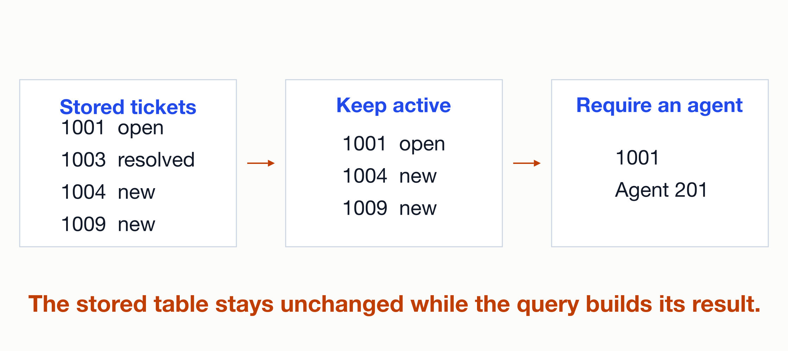

# A missing screen row is not a deleted record



Four stored tickets become three active tickets, then one ticket with a matching agent. Ticket 1001 survives both choices. The original stored table remains unchanged.

The values are worked teaching examples. The timestamp-tie figure is explicitly illustrative, not part of the fixture. The source script contains six course diagrams; render this week’s `StoredAndDisplayed` class with:

```sh
manim -s -r 2240,1000 teaching_stills.py StoredAndDisplayed
```

The PNG is a still diagram, not an embedded movie. Original course diagram: CC BY-NC-SA 4.0; editable code: MIT.
