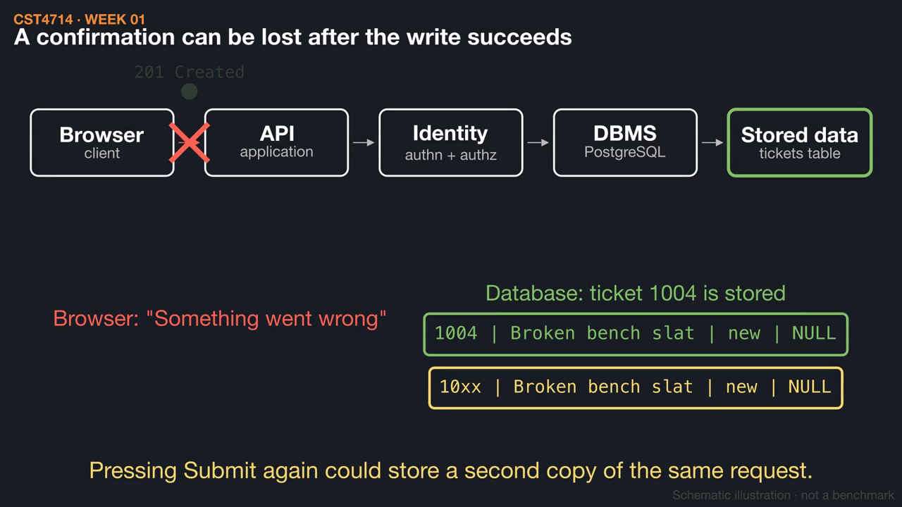
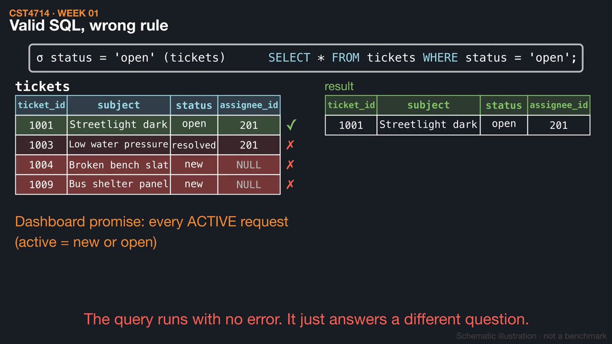
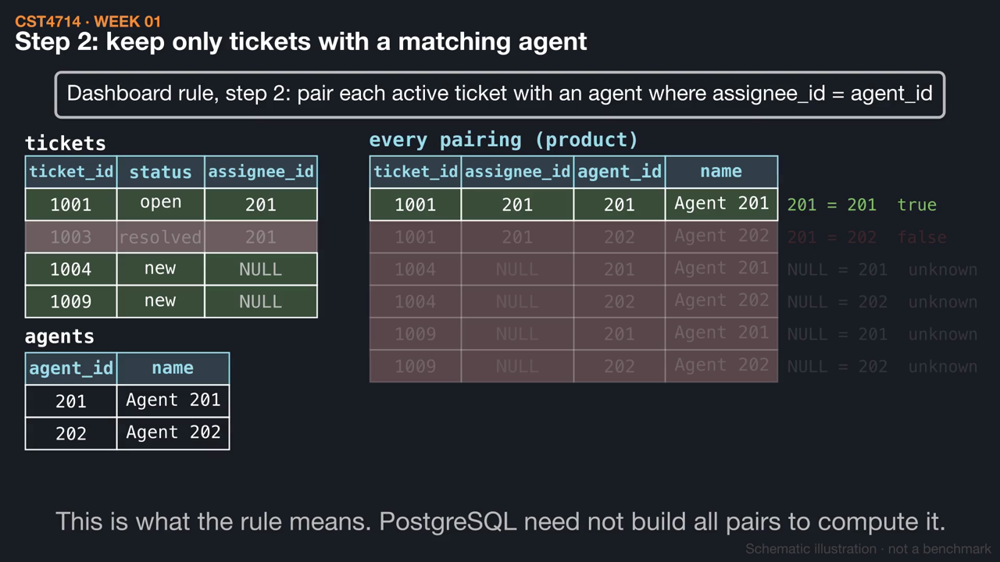

# Week 1 videos

Short silent animations with on-screen captions. Each video has a matching `.srt` subtitle file. Diagrams are schematic illustrations, not benchmarks.

## [Following one request](01_request_path.mp4) (1:24)

A new ticket travels from the browser through the API, identity checks, and the DBMS to a committed row. A lost reply is not a lost write, and the dashboard is a separate read.

[Watch](01_request_path.mp4) · [Subtitles](01_request_path.srt)

## [Selection and projection](02_selection_projection.mp4) (1:34)

Selection keeps the rows that satisfy a condition; projection keeps the columns you name. Neither changes the stored table, and a valid condition can still encode the wrong business rule.

[Watch](02_selection_projection.mp4) · [Subtitles](02_selection_projection.srt)

## [Where did the requests go?](03_missing_requests.mp4) (1:18)

The dashboard keeps active tickets, then keeps only those with a matching agent. NULL assignees match nothing, so two stored requests never reach the screen.

[Watch](03_missing_requests.mp4) · [Subtitles](03_missing_requests.srt)

Editable source: `course/animations/week_01/` in the course authoring folder. Videos © 2026 Atilio Barreda, CC BY-NC-SA 4.0; source code MIT.
