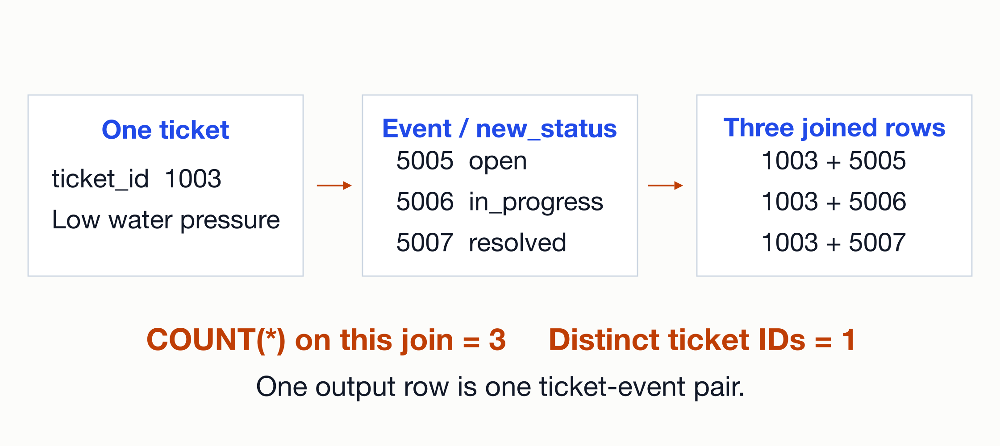

# Read one joined row before counting it



Ticket 1003 joins to events 5005, 5006, and 5007, with new statuses open, in_progress, and resolved. Three joined rows represent three ticket-event pairs but only one distinct ticket.

The values are worked teaching examples. The timestamp-tie figure is explicitly illustrative, not part of the fixture. The source script contains six course diagrams; render this week’s `JoinGrain` class with:

```sh
manim -s -r 2240,1000 teaching_stills.py JoinGrain
```

The PNG is a still diagram, not an embedded movie. Original course diagram: CC BY-NC-SA 4.0; editable code: MIT.
