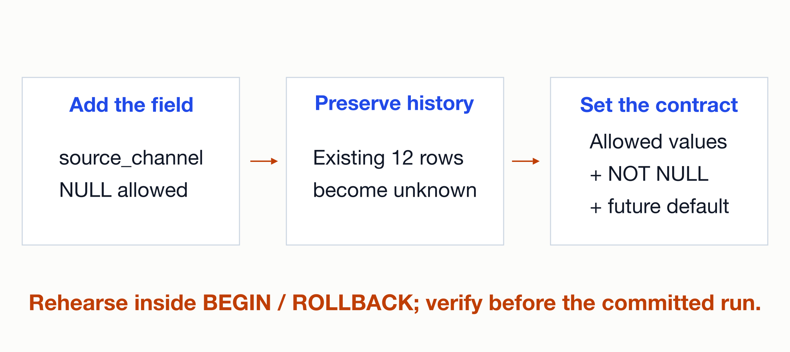

# Change the contract without inventing old facts



A source_channel field is first nullable, twelve historical rows receive unknown, and allowed values, NOT NULL, and a future default establish the new contract. Rehearsal happens inside BEGIN and ROLLBACK.

The values are worked teaching examples. The timestamp-tie figure is explicitly illustrative, not part of the fixture. The source script contains six course diagrams; render this week’s `SafeMigration` class with:

```sh
manim -s -r 2240,1000 teaching_stills.py SafeMigration
```

The PNG is a still diagram, not an embedded movie. Original course diagram: CC BY-NC-SA 4.0; editable code: MIT.
