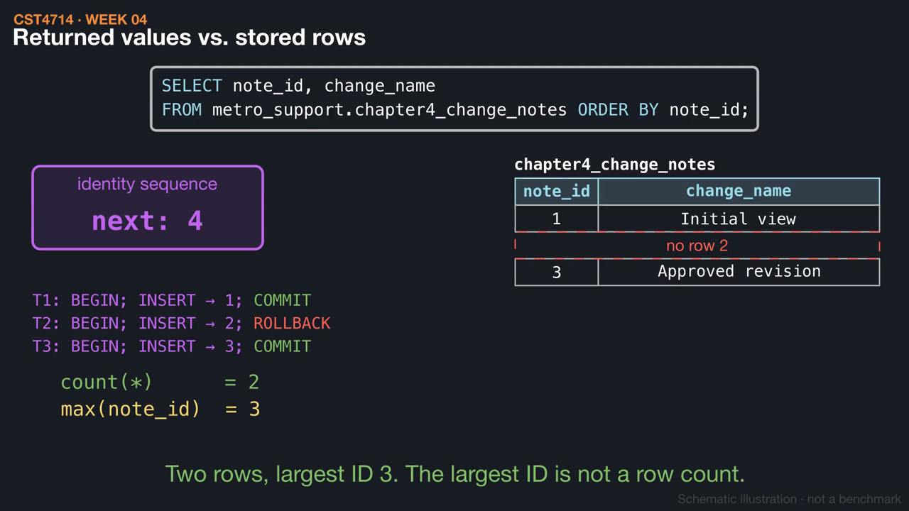
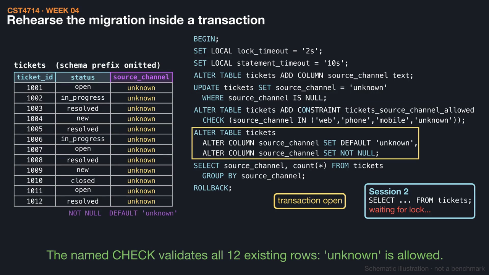

# Week 3 videos

Short silent animations with on-screen captions. Each video has a matching `.srt` subtitle file. Diagrams are schematic illustrations, not benchmarks.

## [A view stores a query, not rows](01_view_stored_query.mp4) (1:14)

The active-queue view saves a SELECT definition and runs it against current data each time, so a resolved ticket simply stops appearing. A materialized view stores rows instead and stays stale until it is refreshed.

[Watch](01_view_stored_query.mp4) · [Subtitles](01_view_stored_query.srt)

## [Why identity values have gaps](02_identity_gaps.mp4) (1:24)

Three inserts receive IDs 1, 2, and 3, but the rolled-back one leaves only rows 1 and 3, because sequence allocations are not undone. An explicitly supplied ID does not advance the sequence and can collide with a later generated value.

[Watch](02_identity_gaps.mp4) · [Subtitles](02_identity_gaps.srt)

## [Adding a required field without inventing history](03_add_required_column.mp4) (1:27)

The source_channel rehearsal adds a column, backfills unknown, adds a CHECK, default, and NOT NULL, verifies, and rolls back. An older client that omits the column gets the default, and an open ALTER TABLE makes other sessions wait.

[Watch](03_add_required_column.mp4) · [Subtitles](03_add_required_column.srt)

Videos © 2026 Atilio Barreda, CC BY-NC-SA 4.0; source code MIT.
