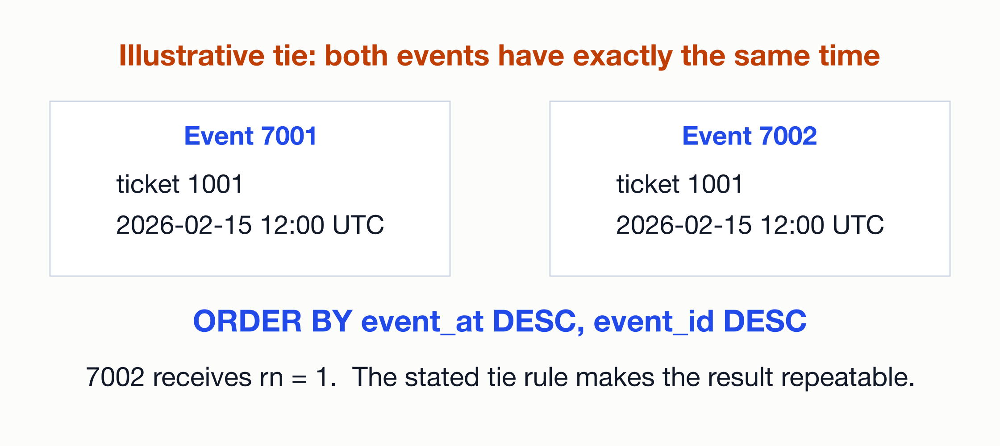

# Define latest when timestamps tie



Two explicitly illustrative events 7001 and 7002 share ticket 1001 and the timestamp February 15, 2026 at noon UTC. Ordering by time descending then event ID descending gives event 7002 row number one.

The values are worked teaching examples. The timestamp-tie figure is explicitly illustrative, not part of the fixture. The source script contains six course diagrams; render this week’s `LatestEventRule` class with:

```sh
manim -s -r 2240,1000 teaching_stills.py LatestEventRule
```

The PNG is a still diagram, not an embedded movie. Original course diagram: CC BY-NC-SA 4.0; editable code: MIT.
