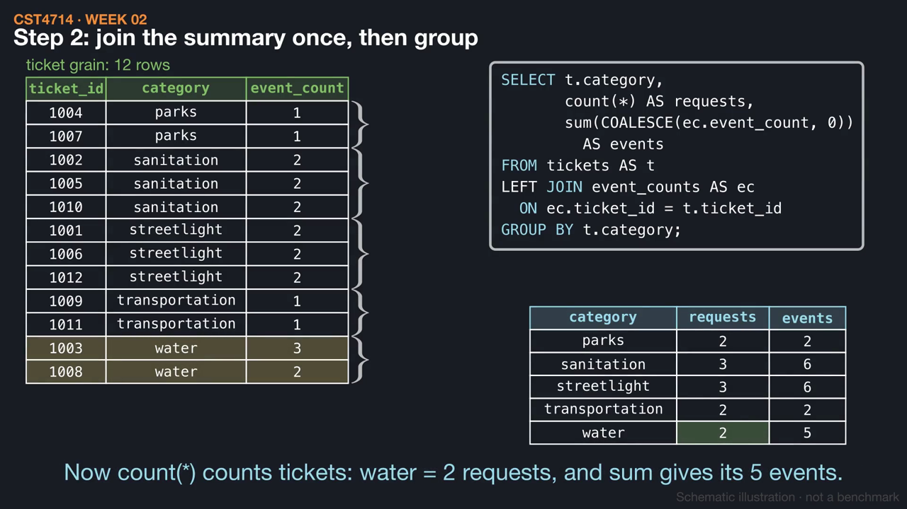
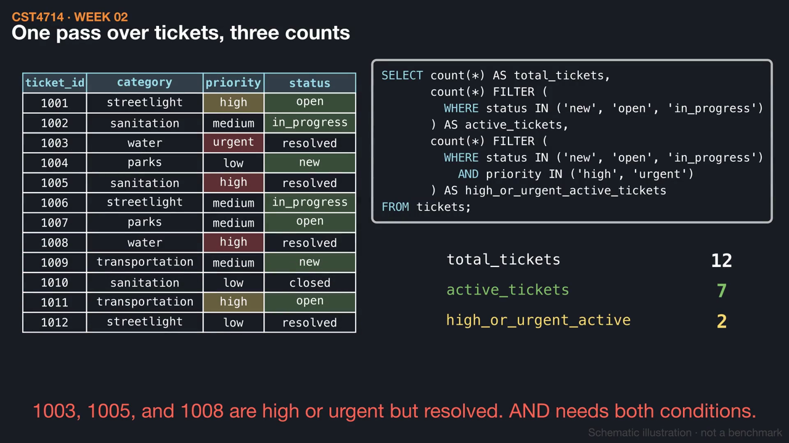
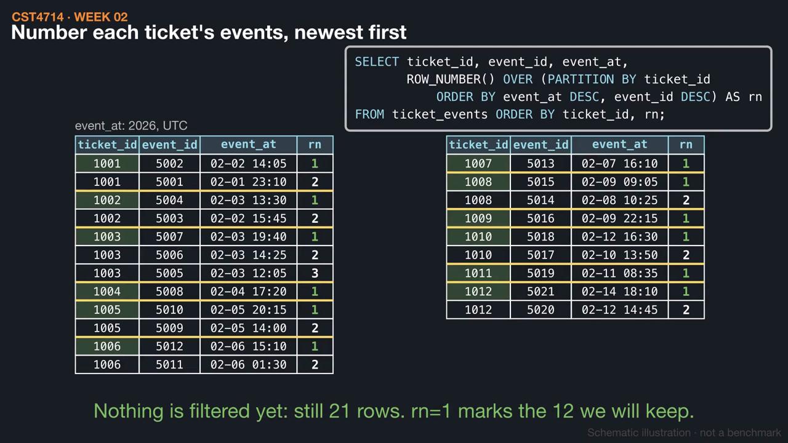

# Week 4 videos

Short silent animations with on-screen captions. Each video has a matching `.srt` subtitle file. Diagrams are schematic illustrations, not benchmarks.

## [Count requests, not ticket-event pairs](04_count_at_grain.mp4) (1:30)

A category report that joins raw events counts water as 5 requests: ticket 1003 three times and 1008 twice. Summarizing events per ticket in a CTE first gives 12 requests and 21 events, and a second query checks the water row.

[Watch](04_count_at_grain.mp4) · [Subtitles](04_count_at_grain.srt)

## [Conditional counts without losing tickets](05_conditional_counts.mp4) (1:19)

count(*) FILTER (WHERE ...) computes 12 total, 7 active, and 2 high-or-urgent active tickets in one pass. Per category, FILTER keeps parks and transportation with a zero, while a top-level WHERE removes them before any count.

[Watch](05_conditional_counts.mp4) · [Subtitles](05_conditional_counts.srt)

## [One latest event per ticket](06_latest_event.mp4) (1:41)

ROW_NUMBER numbers each ticket's events newest first, with event_id breaking timestamp ties, and an outer query keeps rn = 1. A LEFT JOIN from tickets keeps all 12 requests, including unassigned 1004 and 1009.

[Watch](06_latest_event.mp4) · [Subtitles](06_latest_event.srt)

Videos © 2026 Atilio Barreda, CC BY-NC-SA 4.0; source code MIT.
