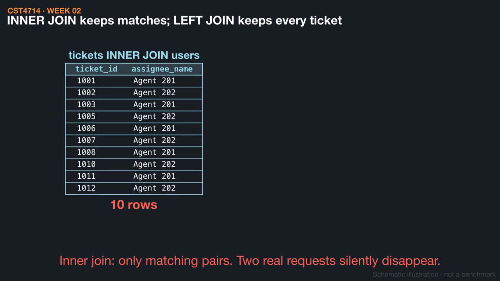
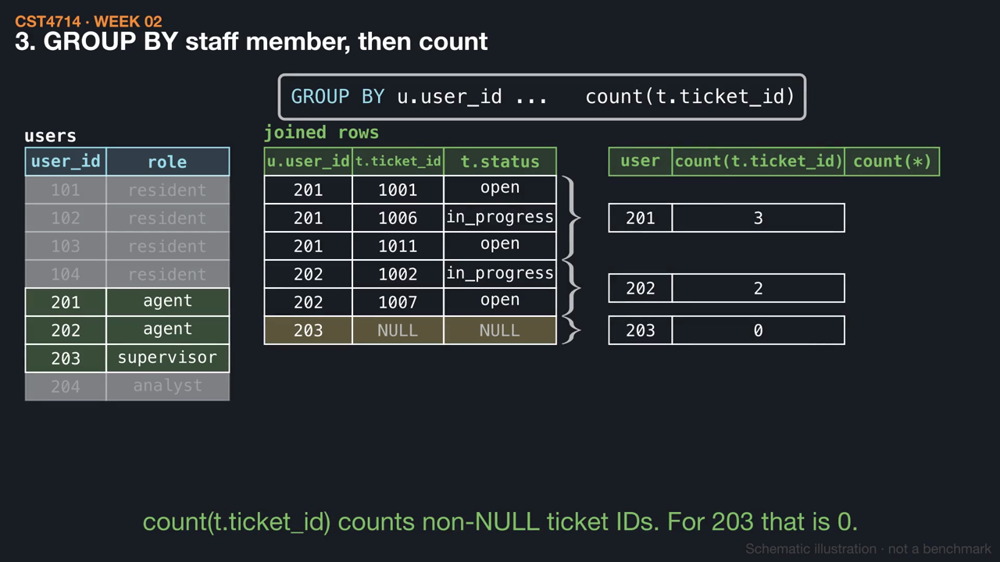
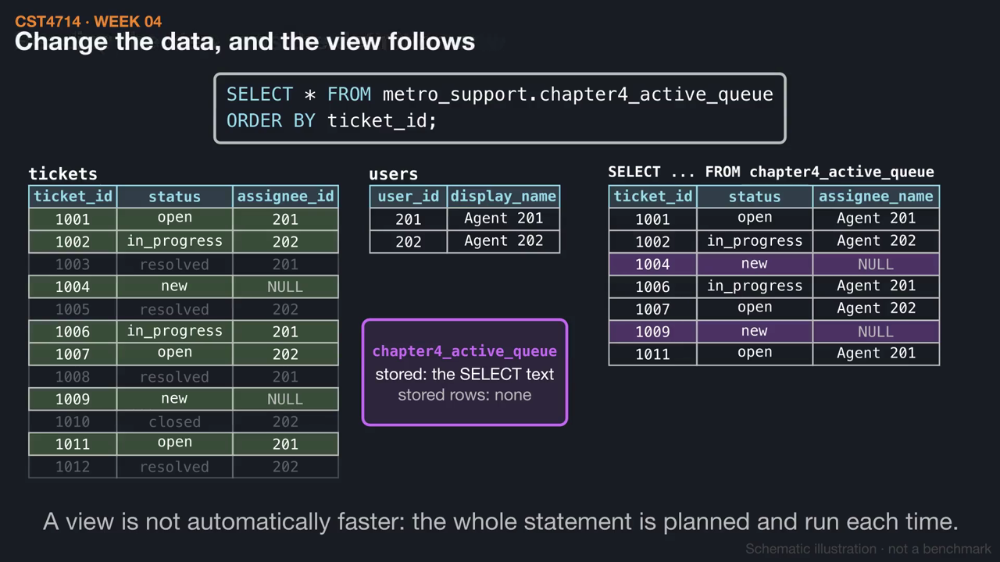

# Week 4 videos

Short silent animations with on-screen captions. Each video has a matching `.srt` subtitle file. Diagrams are schematic illustrations, not benchmarks.

## [What does one row mean after a join?](02_join_grain.mp4) (1:16)

A join is a filtered product: 96 ticket-user pairs become 10 matches. An inner join drops unassigned tickets, a left join keeps all 12, and joining events changes the grain to 21 ticket-event rows.

[Watch](02_join_grain.mp4) · [Subtitles](02_join_grain.srt)

## [Counting workload, including zero](03_zero_counts.mp4) (1:28)

Start from staff, left join active tickets, then group. count(t.ticket_id) gives Agent 203 a zero where count(*) would say one, and moving the status test into WHERE makes 203 vanish.

[Watch](03_zero_counts.mp4) · [Subtitles](03_zero_counts.srt)

## [A view stores a query, not rows](01_view_stored_query.mp4) (1:14)

The active-queue view saves a SELECT definition and runs it against current data each time, so a resolved ticket simply stops appearing. A materialized view stores rows instead and stays stale until it is refreshed.

[Watch](01_view_stored_query.mp4) · [Subtitles](01_view_stored_query.srt)

Videos © 2026 Atilio Barreda, CC BY-NC-SA 4.0; source code MIT.
