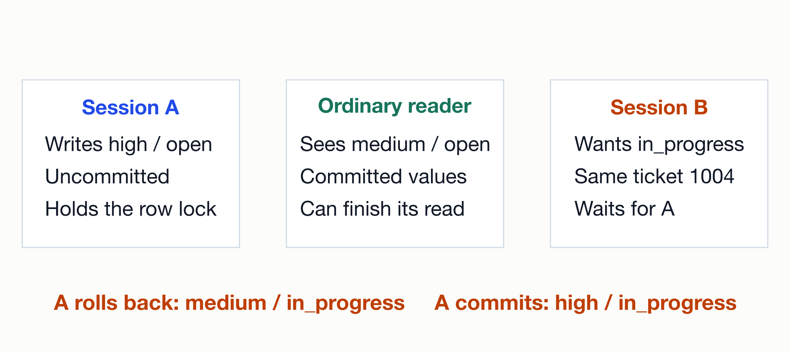

# One row, three sessions, two possible endings



Session A changes ticket 1004 to high/open without committing and holds its row lock. An ordinary reader sees committed medium/open. Session B waits to set in_progress. A rollback leaves medium/in_progress; A commit leaves high/in_progress.

The values are worked teaching examples. The timestamp-tie figure uses two illustrative rows. The source script contains six course diagrams; render this week’s `WaitingWriter` class with:

```sh
manim -s -r 2240,1000 teaching_stills.py WaitingWriter
```

The PNG shows the diagram. Original course diagram: CC BY-NC-SA 4.0; editable code: MIT.
