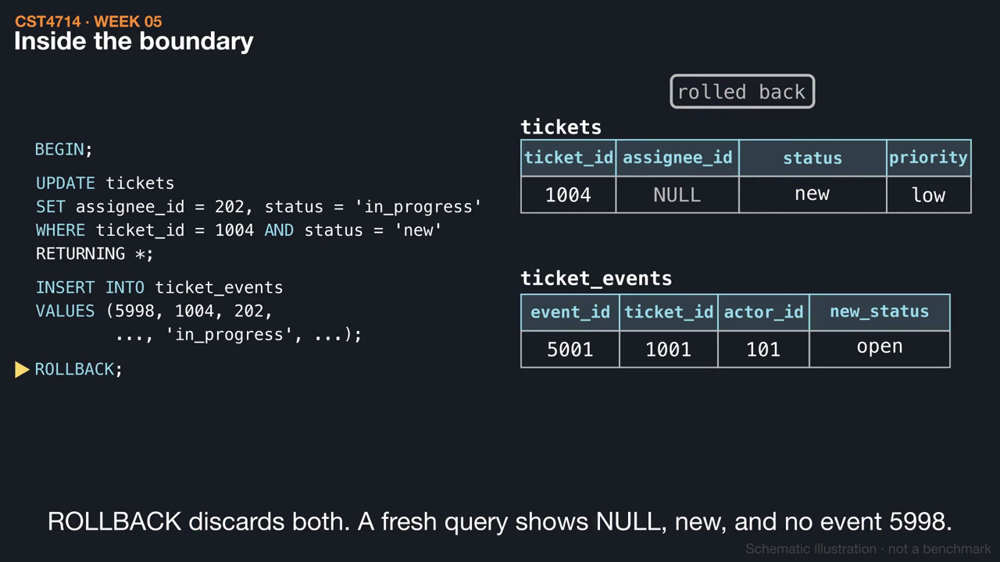
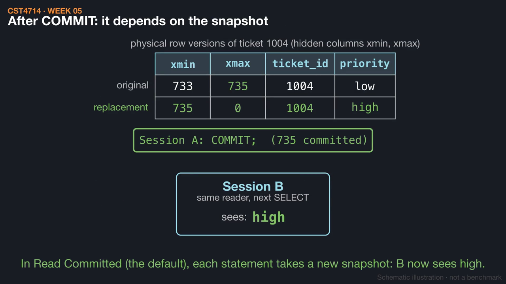
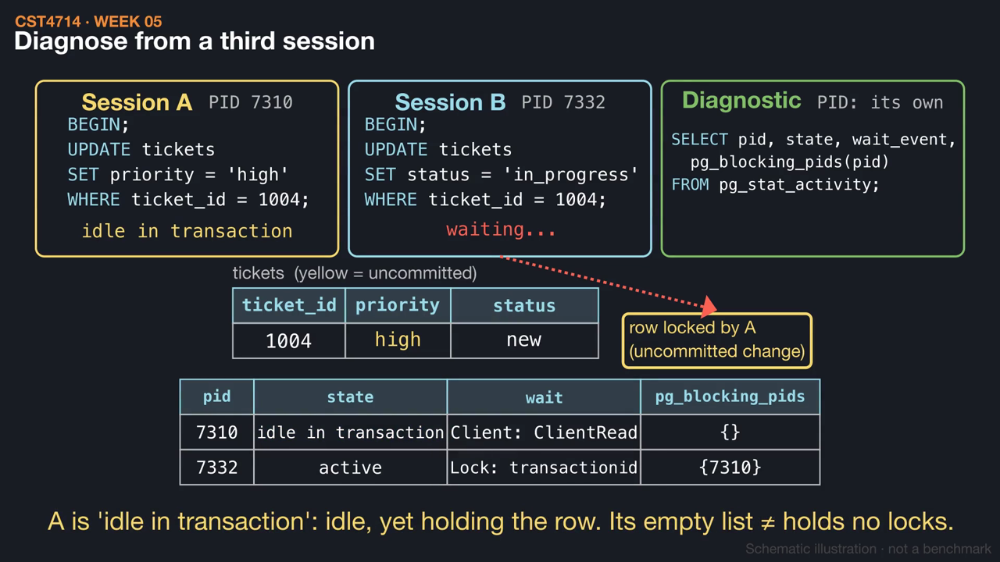

# Week 5 videos

Short silent animations with on-screen captions. Each video has a matching `.srt` subtitle file. Diagrams are schematic illustrations, not benchmarks.

## [One assignment, one transaction](01_transaction_boundary.mp4) (1:28)

Assigning ticket 1004 changes the ticket and writes event 5998, so both belong in one transaction. Watch ROLLBACK and COMMIT end it, a duplicate-key error fail the pair, and an UPDATE match zero rows without any error.

[Watch](01_transaction_boundary.mp4) · [Subtitles](01_transaction_boundary.srt)

## [Row versions and snapshots](02_mvcc_row_versions.mp4) (1:22)

An UPDATE to ticket 1004 writes a new row version stamped with transaction IDs. See which version each session reads before and after the commit, and why VACUUM can reclaim the old version only when no snapshot needs it.

[Watch](02_mvcc_row_versions.mp4) · [Subtitles](02_mvcc_row_versions.srt)

## [Who is waiting on whom?](03_blocking_and_deadlock.mp4) (1:28)

Session A updates ticket 1004 and leaves its transaction open, so Session B waits. A third session uses pg_blocking_pids to find the blocker, and ending A decides which data survives. A deadlock is different: it is a cycle that PostgreSQL breaks by aborting one transaction.

[Watch](03_blocking_and_deadlock.mp4) · [Subtitles](03_blocking_and_deadlock.srt)

Editable source: `course/animations/week_05/` in the course authoring folder. Videos © 2026 Atilio Barreda, CC BY-NC-SA 4.0; source code MIT.
