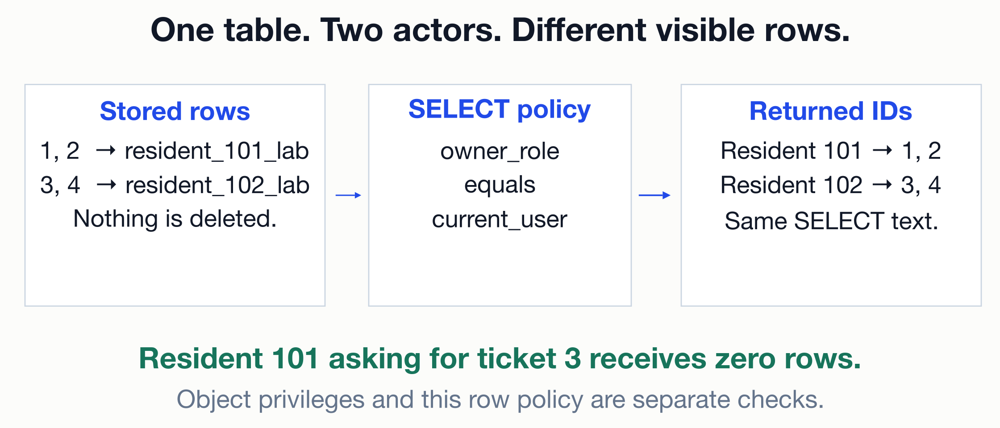

# Week 6: Static Concept Diagram



Both residents read one table. The SELECT policy compares owner_role to current_user, returning IDs 1–2 for Resident 101 and 3–4 for Resident 102. A direct lookup of ticket 3 by Resident 101 returns zero rows without deleting it.

This is a static Manim illustration, not a video. Its editable [source](course_stills.py) contains the coursewide set; render this week’s scene with:

```sh
manim -s -r 2240,960 --disable_caching course_stills.py OwnershipStill
```

Original course illustration: CC BY-NC-SA 4.0. It appears in the worked-example appendix of the weekly PowerPoint and PDF.
