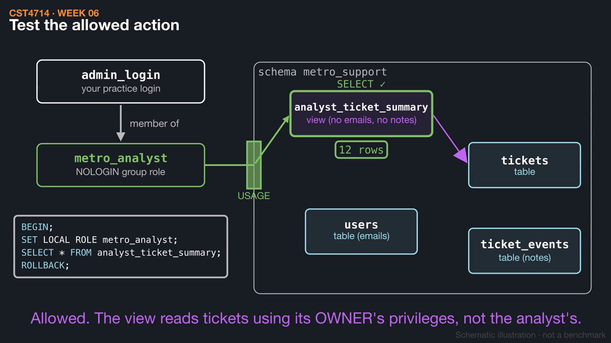
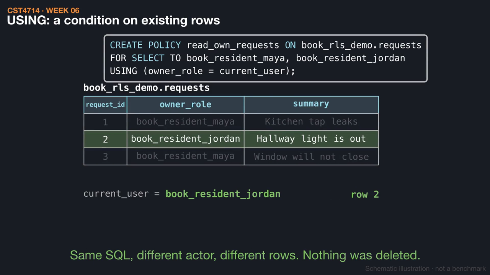
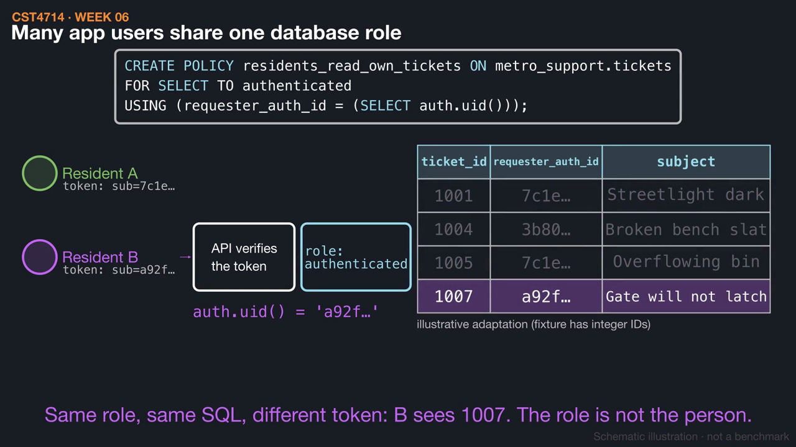

# Week 6 videos

Short silent animations with on-screen captions. Each video has a matching `.srt` subtitle file. Diagrams are schematic illustrations, not benchmarks.

## [Least privilege: roles and grants](01_roles_and_grants.mp4) (1:24)

A NOLOGIN group role gets schema USAGE and SELECT on one reporting view, and nothing else. Test one allowed read and two denied actions that fail with 42501, and see why a REVOKE alone does not prove the access is gone.

[Watch](01_roles_and_grants.mp4) · [Subtitles](01_roles_and_grants.srt)

## [Row-level security: USING and WITH CHECK](02_row_level_security.mp4) (1:30)

Two residents run the same SELECT on one table and get different rows, because the policy compares owner_role with current_user. Guessing another ID returns zero rows, while inserting a row with a false owner raises an error.

[Watch](02_row_level_security.mp4) · [Subtitles](02_row_level_security.srt)

## [Who is asking? Gates, roles, and tokens](03_who_is_asking.mp4) (1:33)

A query must pass network, TLS, authentication, privilege, and row-policy gates, and each failure looks different. In Supabase, many users share the authenticated role and the policy tells them apart with auth.uid(), while owners and BYPASSRLS roles skip the policy entirely.

[Watch](03_who_is_asking.mp4) · [Subtitles](03_who_is_asking.srt)

Editable source: `course/animations/week_06/` in the course authoring folder. Videos © 2026 Atilio Barreda, CC BY-NC-SA 4.0; source code MIT.
