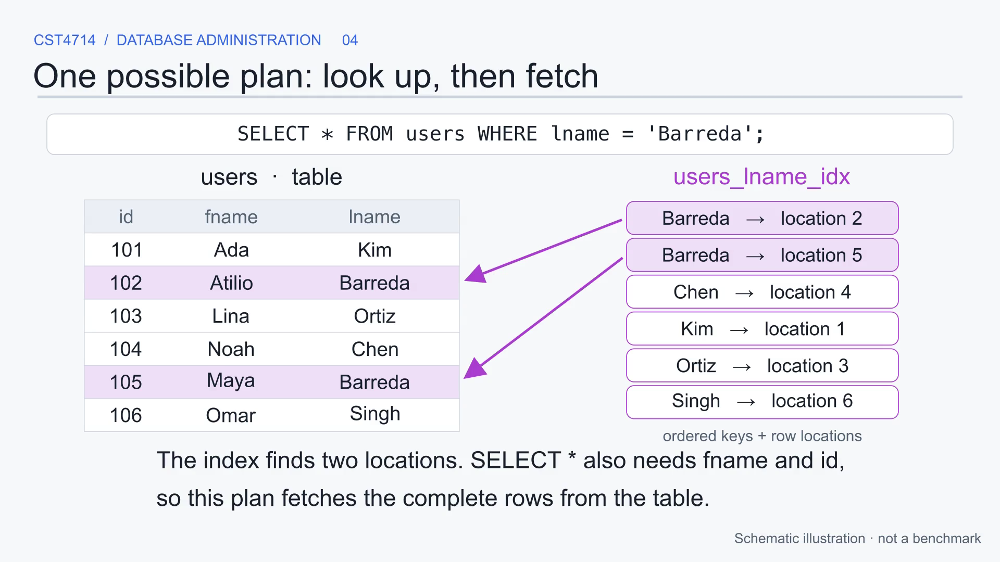

# When Does an Index Help?

A captioned Manim animation for CST4714 Database Administration, by Atilio Barreda.

[Watch or download the animation](index_usefulness.mp4) · [Caption file](index_usefulness.srt) · [Editable Manim source](index_usefulness.py)



The video uses the same two queries as the classroom sketch:

```sql
SELECT * FROM users;
SELECT * FROM users WHERE lname = 'Barreda';
```

It follows a sequential scan, builds an index on `lname`, and shows one possible index lookup with table-row fetches. It then explains why a tiny table, many matching rows, or an index on a different column can make the index less useful. The final scene shows how to inspect the actual PostgreSQL plan.

The index definition is `CREATE INDEX users_lname_idx ON users (lname);`. The column in `ON (...)` determines what is indexed; the name is only a label. Creating this index does not rearrange the table or guarantee result order.

The six-row table, simplified index entries, and page diagrams illustrate mechanisms. They are not a recorded query plan, a literal B-tree layout, or a benchmark. A real six-row table may use a sequential scan even for the filtered query. Each numbered location represents a table-row location, not an index containing the full record.

## Chapters

- 00:00 — When does an index help?
- 00:06 — Without a matching index: inspect the table
- 00:17 — Build a separate structure for last names
- 00:27 — One possible plan: look up, then fetch
- 00:43 — No WHERE clause: every row is still needed
- 00:54 — How much of the table must PostgreSQL visit?
- 01:12 — The indexed column must fit the search
- 01:23 — An index has a storage and maintenance cost
- 01:33 — An index is an option. Check the chosen plan.

## Use in class

The video is silent, with explanations on screen. Pause after the lookup and ask why `SELECT *` still needs the table. After the page diagram, ask why finding fewer output rows does not necessarily mean visiting fewer pages. Finish by asking what evidence would justify keeping the index.

`EXPLAIN (ANALYZE, BUFFERS)` executes the query. The example is a read-only SELECT. Compare the same query and data before and after; check the returned rows as well as the plan and buffers. No particular scan type or speedup is promised.

## Render or edit

Install [uv](https://docs.astral.sh/uv/) and the system prerequisites from the [Manim installation guide](https://docs.manim.community/en/stable/installation/uv.html). The animation uses Text objects and does not need LaTeX. Cairo/Pango and FFmpeg are needed for rendering. Arial and Menlo are the reference fonts; replace the two font names in the source if unavailable.

Run these commands from this folder:

```sh
uv sync --locked
uv run manim -qh --fps 30 index_usefulness.py IndexUsefulness
```

Manim writes the video below `media/videos/index_usefulness/1080p30/`, with chapter and caption timing JSON in `media/`. The included MP4 is ready to play without installing Manim. The environment is pinned in `pyproject.toml` and `uv.lock`.

## Sources and license

- [PostgreSQL 15: Indexes Introduction](https://www.postgresql.org/docs/15/indexes-intro.html): matching searches, planner choice, and maintenance cost.
- [PostgreSQL 15: Using EXPLAIN](https://www.postgresql.org/docs/15/using-explain.html): sequential, index, and bitmap plans; costs and actual execution.
- [PostgreSQL 15: Index-Only Scans and Covering Indexes](https://www.postgresql.org/docs/15/indexes-index-only-scans.html): index entries and table-row access.
- [PostgreSQL 15: Indexes and ORDER BY](https://www.postgresql.org/docs/15/indexes-ordering.html): ordered access and result ordering.

Original video, diagrams, captions, and prose © 2026 Atilio Barreda, [CC BY-NC-SA 4.0](https://creativecommons.org/licenses/by-nc-sa/4.0/). Original Python source is MIT licensed. The example people are fictional; the instructor's name is used as a classroom example. External documentation and software retain their own licenses.
