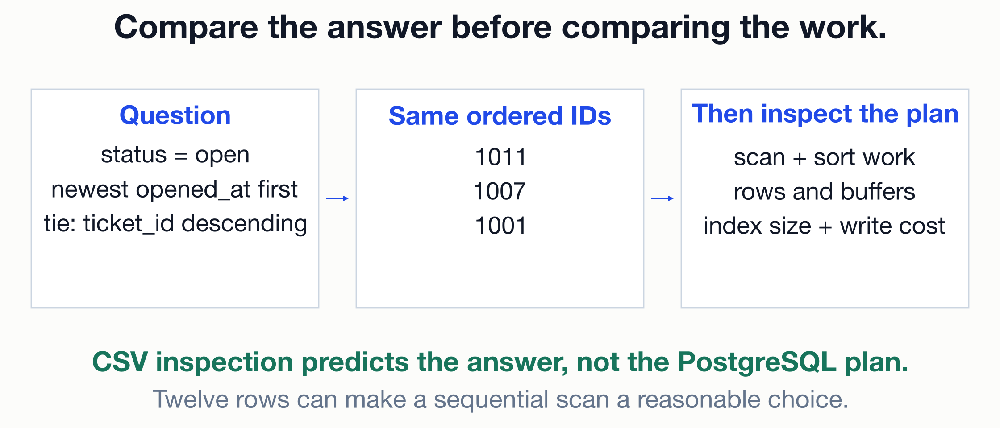

# Week 7: Static Concept Diagram



The newest-open-ticket question yields ordered IDs 1011, 1007, 1001. Preserve that answer when comparing PostgreSQL scan and sort work, buffers, and index cost. CSV inspection does not reveal the database plan.

This is a static Manim illustration, not a video. Its editable [source](course_stills.py) contains the coursewide set; render this week’s scene with:

```sh
manim -s -r 2240,960 --disable_caching course_stills.py IndexEvidenceStill
```

Original course illustration: CC BY-NC-SA 4.0. It appears in the worked-example appendix of the weekly PowerPoint and PDF.
