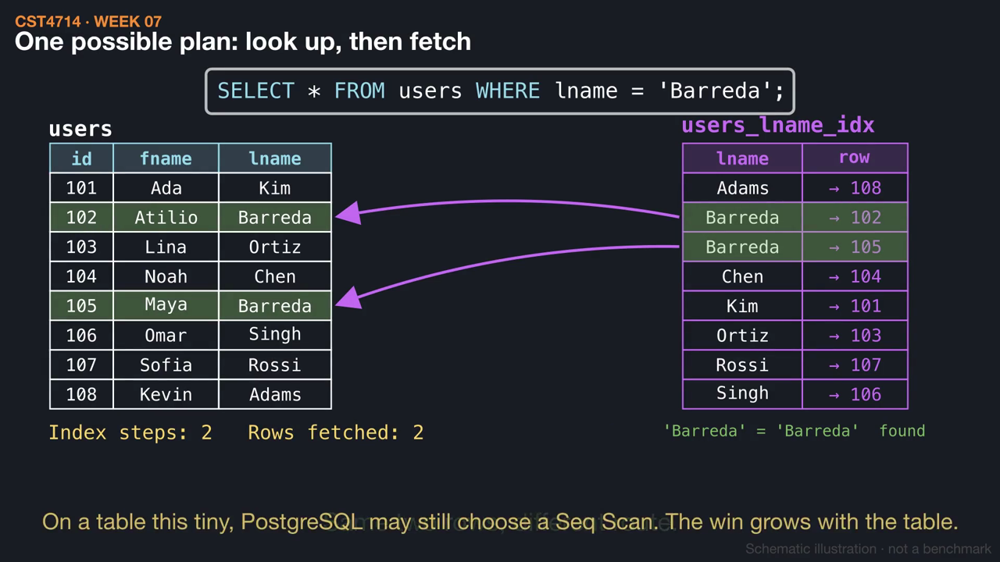
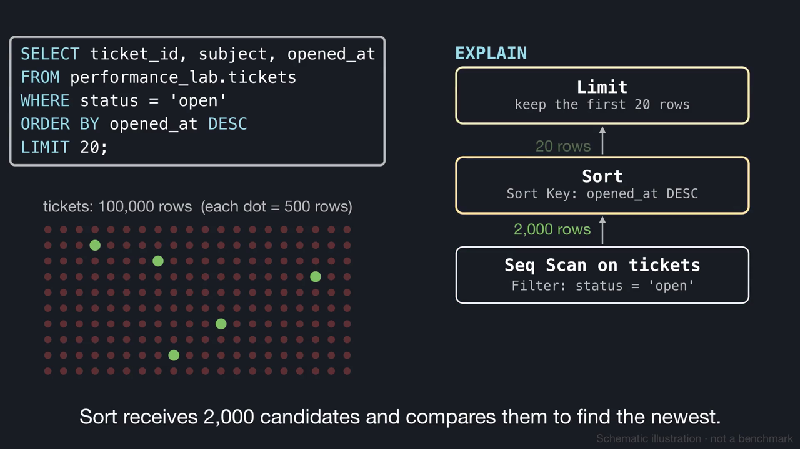
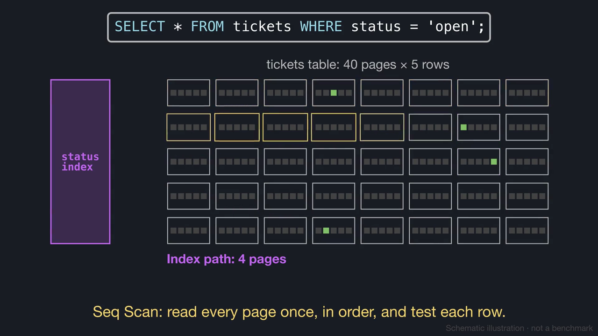
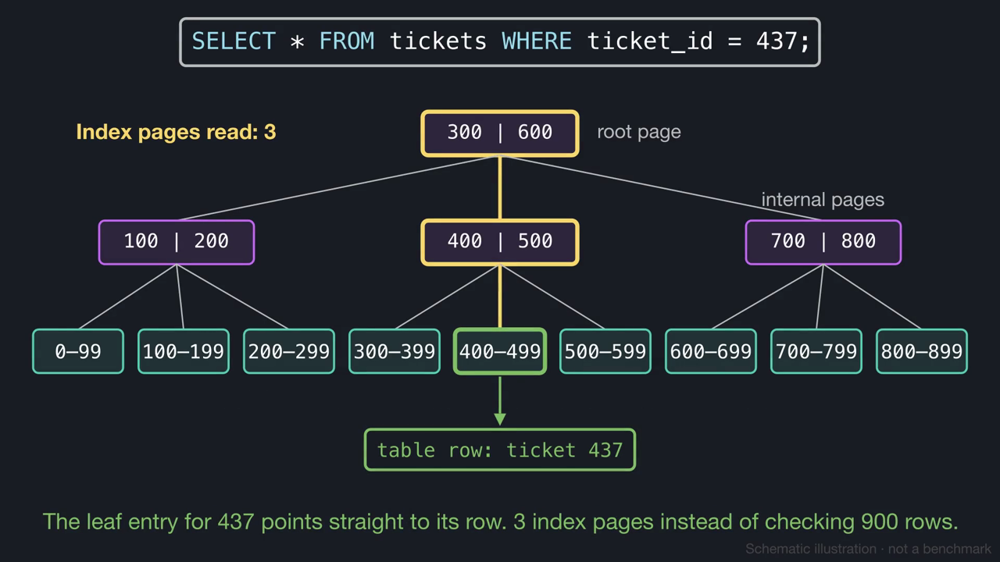
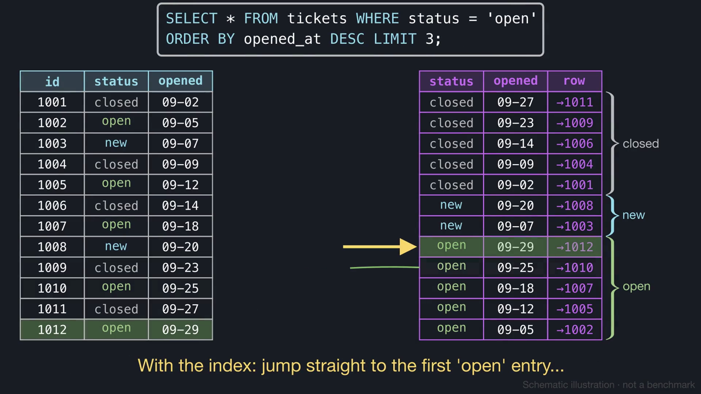
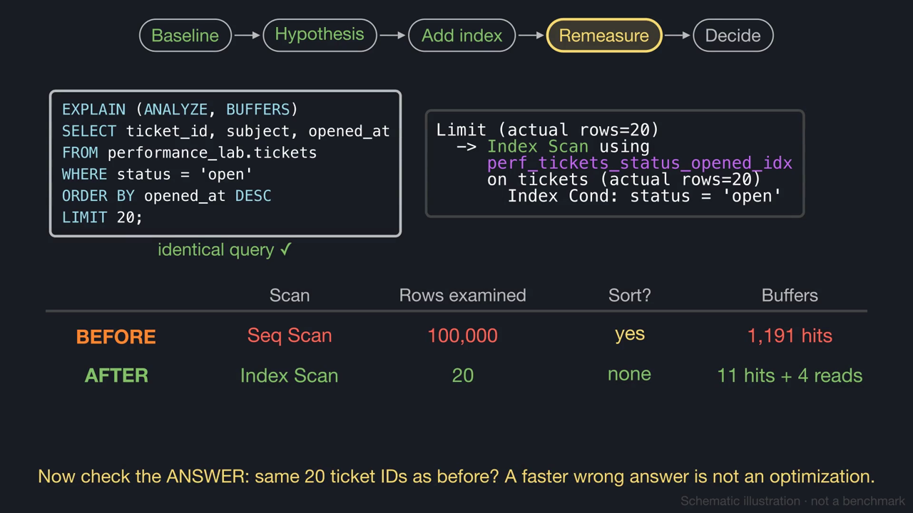

# Week 7 videos

Short silent animations with on-screen captions. Each video has a matching `.srt` subtitle file. Diagrams are schematic illustrations, not benchmarks.

## [When does an index help?](01_index_usefulness.mp4) (1:44)

A last-name index finds two matching rows by looking up, then fetching. It cannot help a query with no WHERE clause or one on a different column, and every INSERT has to maintain it.

[Watch](01_index_usefulness.mp4) · [Subtitles](01_index_usefulness.srt)

## [Reading a query plan](02_reading_a_query_plan.mp4) (0:55)

SQL describes the answer and the plan describes the work. Read the plan tree inside out and follow 100,000 rows down to 20, then compare EXPLAIN with EXPLAIN ANALYZE.

[Watch](02_reading_a_query_plan.mp4) · [Subtitles](02_reading_a_query_plan.srt)

## [Selectivity: why a Seq Scan can beat an index](03_selectivity.mp4) (1:07)

Tables are read in pages. When 2% of the rows match, an index skips most pages. When 80% match, reading every page once is cheaper.

[Watch](03_selectivity.mp4) · [Subtitles](03_selectivity.srt)

## [How a B-tree index finds rows](04_btree_index.mp4) (0:58)

Root, internal, and leaf pages narrow an equality search to a few page reads. Linked leaves serve ranges and ORDER BY, and the depth grows very slowly.

[Watch](04_btree_index.mp4) · [Subtitles](04_btree_index.srt)

## [Composite indexes: column order matters](05_composite_index.mp4) (1:08)

An index on (status, opened_at DESC) answers "newest 20 open tickets" without a scan or a sort. Filtering on only its second column scatters the matches.

[Watch](05_composite_index.mp4) · [Subtitles](05_composite_index.srt)

## [Testing an index hypothesis](06_index_experiment.mp4) (1:03)

Baseline, hypothesis, add index, remeasure, decide: the textbook's worked example, comparing plan shape, rows, sort, and buffers, and checking for the same answer.

[Watch](06_index_experiment.mp4) · [Subtitles](06_index_experiment.srt)

Editable source: `course/animations/week_07/` in the course authoring folder. Videos © 2026 Atilio Barreda, CC BY-NC-SA 4.0; source code MIT.
