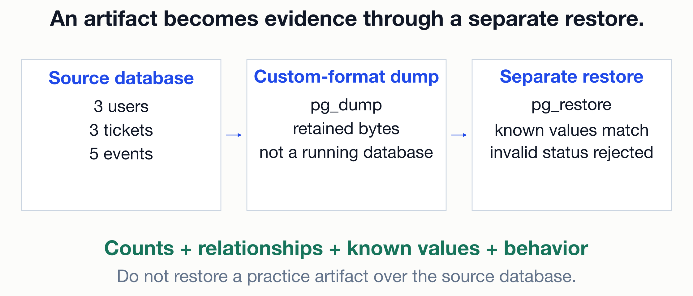

# Week 8: Static Concept Diagram



A source database with 3 users, 3 tickets, and 5 events produces a custom-format archive. Restore into a separate database, then check counts, relationships, known values, and rejection of an invalid status.

This Manim illustration shows the lesson records. Its editable [source](course_stills.py) contains the coursewide set; render this week’s scene with:

```sh
manim -s -r 2240,960 --disable_caching course_stills.py RecoveryStill
```

Original course illustration: CC BY-NC-SA 4.0. It appears in the worked-example appendix of the weekly PowerPoint and PDF.
