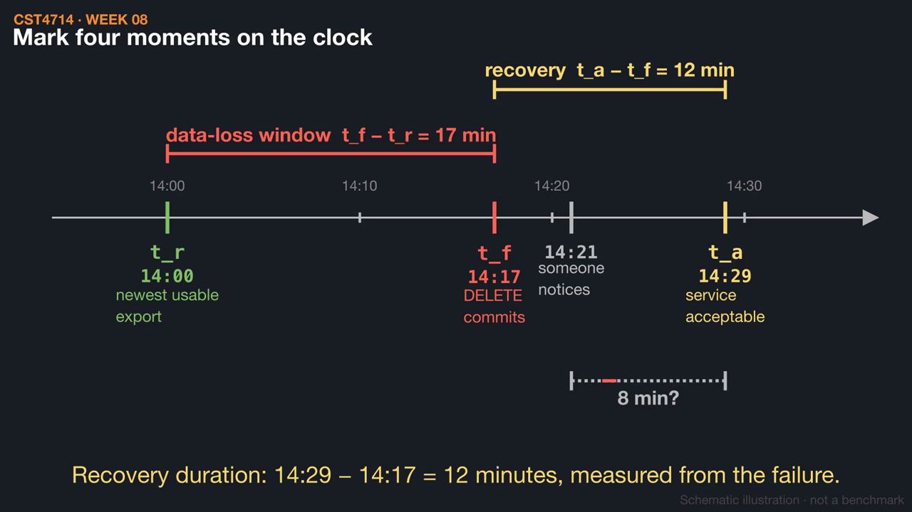
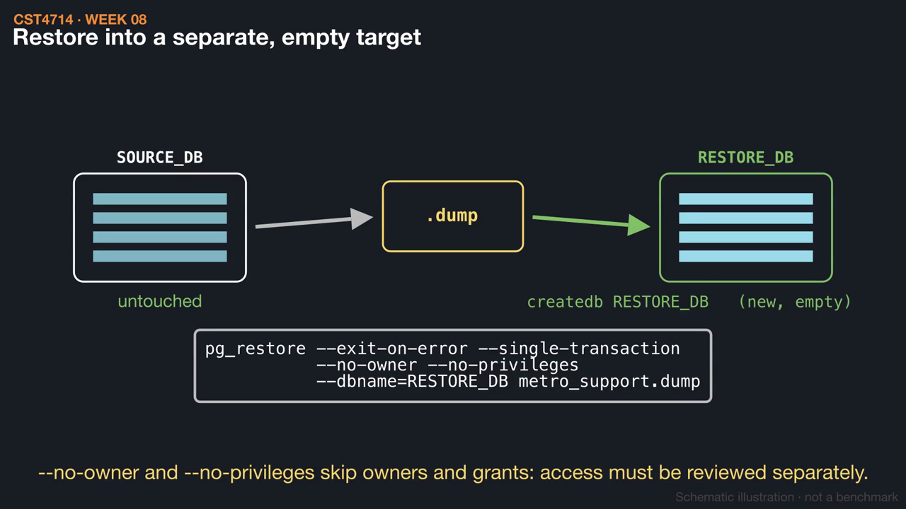
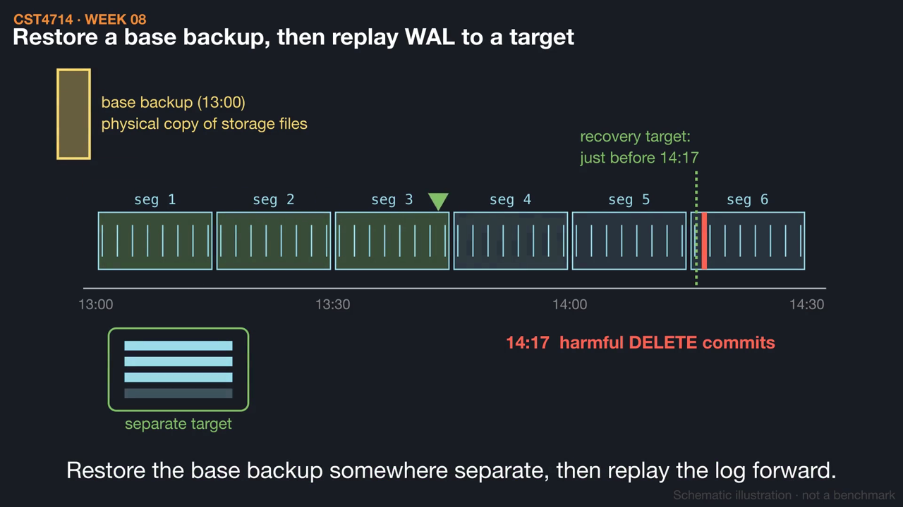

# Week 8 videos

Short silent animations with on-screen captions. Each video has a matching `.srt` subtitle file. Diagrams are schematic illustrations, not benchmarks.

## [RPO and RTO on the clock](01_rpo_rto_clock.mp4) (1:29)

A committed DELETE survives restarts and is copied to a replica, so recovery needs an earlier state. The chapter's 14:00 / 14:17 / 14:29 scenario shows a 17-minute data-loss window and a 12-minute recovery, missing both a 5-minute RPO and a 10-minute RTO.

[Watch](01_rpo_rto_clock.mp4) · [Subtitles](01_rpo_rto_clock.srt)

## [Dump, restore, verify](02_dump_restore_verify.mp4) (1:35)

pg_dump captures one consistent snapshot, unlike CSVs downloaded at different moments. The archive is restored into a separate empty database, then checked with counts, a known ticket, and an expected constraint failure.

[Watch](02_dump_restore_verify.mp4) · [Subtitles](02_dump_restore_verify.srt)

## [Point-in-time recovery with WAL](03_wal_point_in_time.mp4) (1:20)

A schematic of physical recovery: restore a base backup, then replay retained write-ahead log up to a target just before the harmful 14:17 DELETE. A single missing log segment stops the replay short of the target.

[Watch](03_wal_point_in_time.mp4) · [Subtitles](03_wal_point_in_time.srt)

Editable source: `course/animations/week_08/` in the course authoring folder. Videos © 2026 Atilio Barreda, CC BY-NC-SA 4.0; source code MIT.
