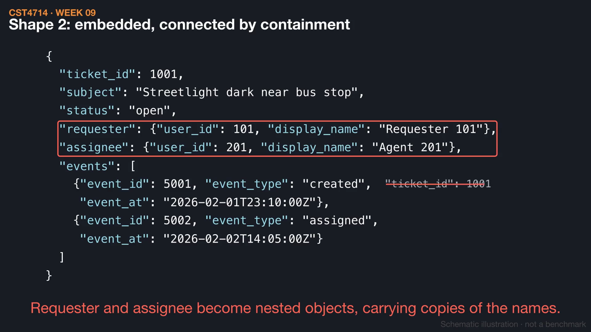
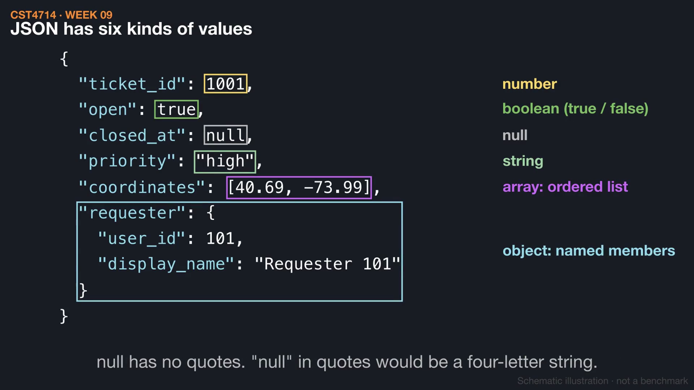
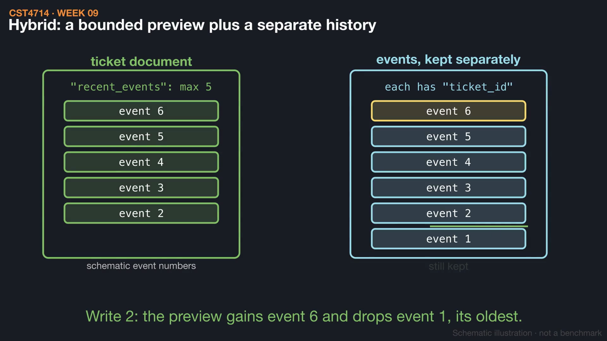

# Week 9 videos

Short silent animations with on-screen captions. Each video has a matching `.srt` subtitle file. Diagrams are schematic illustrations, not benchmarks.

## [Same facts, two shapes](01_rows_to_documents.mp4) (1:16)

Ticket 1001's CSV rows become a referenced JSON object, where IDs connect three arrays, and an embedded ticket document, where containment connects the events. Both keep the same facts but make different reads and changes direct.

[Watch](01_rows_to_documents.mp4) · [Subtitles](01_rows_to_documents.srt)

## [Strict JSON, from the punctuation up](02_json_value_kinds.mp4) (1:20)

The six JSON value kinds and their punctuation, a repair of single quotes and a trailing comma, and why missing, null, empty, and zero differ. JSON has no date type; MongoDB stores BSON, and the sender decides what becomes a Date.

[Watch](02_json_value_kinds.mp4) · [Subtitles](02_json_value_kinds.srt)

## [What embedding costs over time](03_embedding_tradeoffs.mp4) (1:21)

An embedded copy of a user's name goes stale after a name change unless its meaning is defined, and an embedded events array grows without bound. A hybrid keeps a bounded recent-event preview plus a separate history, which takes two writes and a refresh rule.

[Watch](03_embedding_tradeoffs.mp4) · [Subtitles](03_embedding_tradeoffs.srt)

Editable source: `course/animations/week_09/` in the course authoring folder. Videos © 2026 Atilio Barreda, CC BY-NC-SA 4.0; source code MIT.
