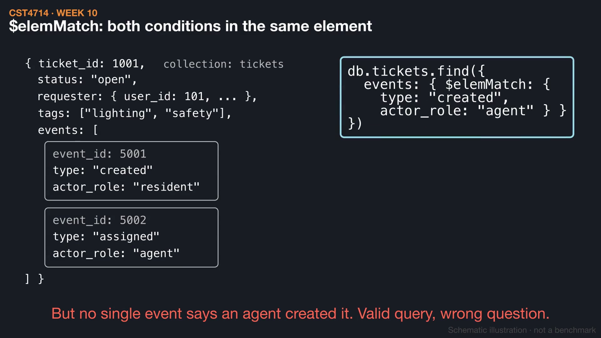
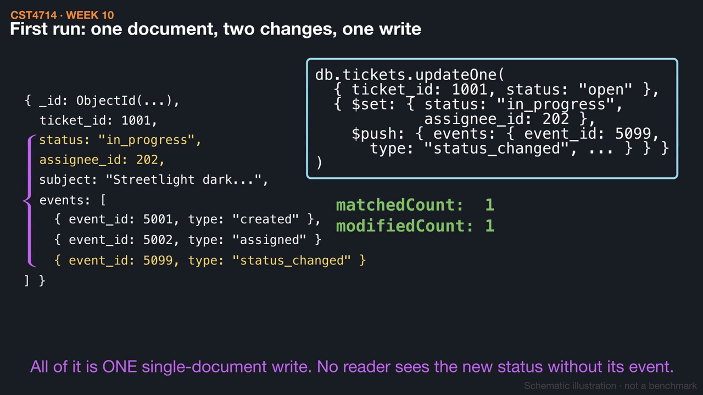
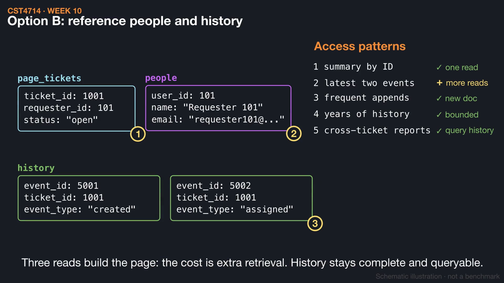

# Week 10 videos

Short silent animations with on-screen captions. Each video has a matching `.srt` subtitle file. Diagrams are schematic illustrations, not benchmarks.

## [Querying inside documents: arrays and $elemMatch](01_array_queries.mp4) (1:12)

Dot paths reach into nested documents, and two dotted conditions on an array can be met by different elements. $elemMatch requires one element to meet both, and it filters documents without trimming the array.

[Watch](01_array_queries.mp4) · [Subtitles](01_array_queries.srt)

## [Did the write do what you meant?](02_update_results.mp4) (1:06)

An updateOne with an expected-state filter changes status and appends an event in one atomic document write. Reading matchedCount and modifiedCount separates success, no match, and already-current values, and replaceOne is shown dropping omitted fields.

[Watch](02_update_results.mp4) · [Subtitles](02_update_results.srt)

## [Embed or reference? Let the workload decide](03_embed_or_reference.mp4) (1:21)

Five access patterns for the ticket page are tested against an embedded events array that keeps growing and a referenced design read in three steps. A contact correction changes one person document, and a new event adds a history document without growing the ticket.

[Watch](03_embed_or_reference.mp4) · [Subtitles](03_embed_or_reference.srt)

Editable source: `course/animations/week_10/` in the course authoring folder. Videos © 2026 Atilio Barreda, CC BY-NC-SA 4.0; source code MIT.
