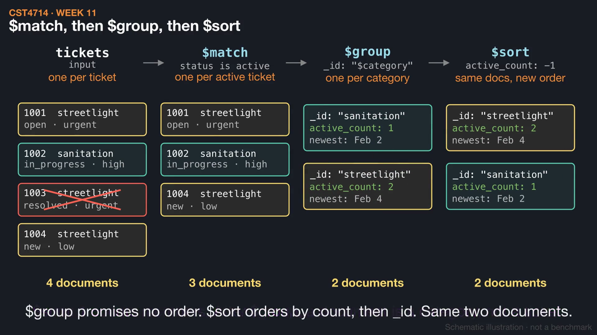
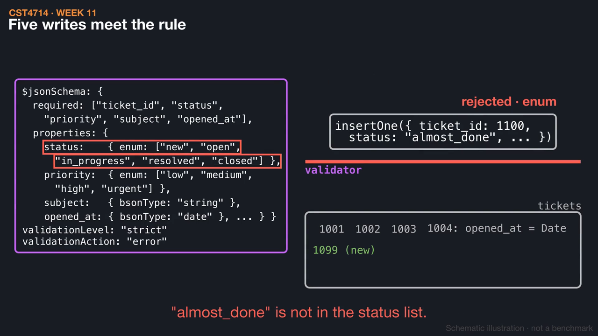
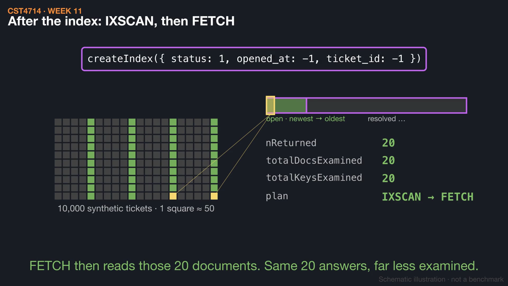

# Week 11 videos

Short silent animations with on-screen captions. Each video has a matching `.srt` subtitle file. Diagrams are schematic illustrations, not benchmarks.

## [Follow the documents through a pipeline](01_pipeline_grain.mp4) (1:11)

Four tickets flow through $match, $group, and $sort, with the grain labeled after each stage. Then $unwind turns tickets into events, and two streams of three documents turn out to count different tickets.

[Watch](01_pipeline_grain.mp4) · [Subtitles](01_pipeline_grain.srt)

## [Schema validation: which documents may exist?](02_schema_validation.mp4) (1:05)

Five writes meet the chapter's $jsonSchema rule: a date-shaped string, a status outside the list, and a missing opened_at are rejected, while a valid ticket and an extra optional field pass. Adding the rule does not fix documents already stored.

[Watch](02_schema_validation.mp4) · [Subtitles](02_schema_validation.srt)

## [Did the index change the work?](03_explain_counts.mp4) (1:18)

The course's 10,000-ticket sort demo read through explain("executionStats"): newest 20 open tickets cost COLLSCAN + SORT over 10,000 documents before the index and IXSCAN + FETCH of 20 after. In a pipeline the index serves only the early stages, and moving $limit changes the answer.

[Watch](03_explain_counts.mp4) · [Subtitles](03_explain_counts.srt)

Editable source: `course/animations/week_11/` in the course authoring folder. Videos © 2026 Atilio Barreda, CC BY-NC-SA 4.0; source code MIT.
