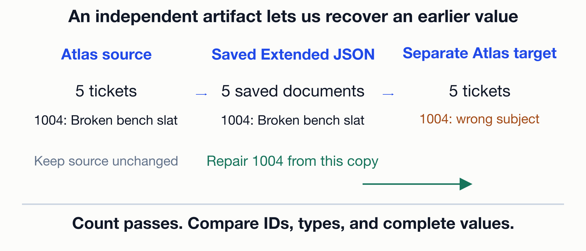

# Week 12 static illustration

The diagram uses the supplied lesson records. [Editable Manim source](course_stills.py). Render with Manim Community 0.22: `manim -s -r 2240,960 course_stills.py Recovery`. The source authors no animation. ExistingMP4 lesson videos and their subtitle files remain separate and are embedded in the PowerPoint.
