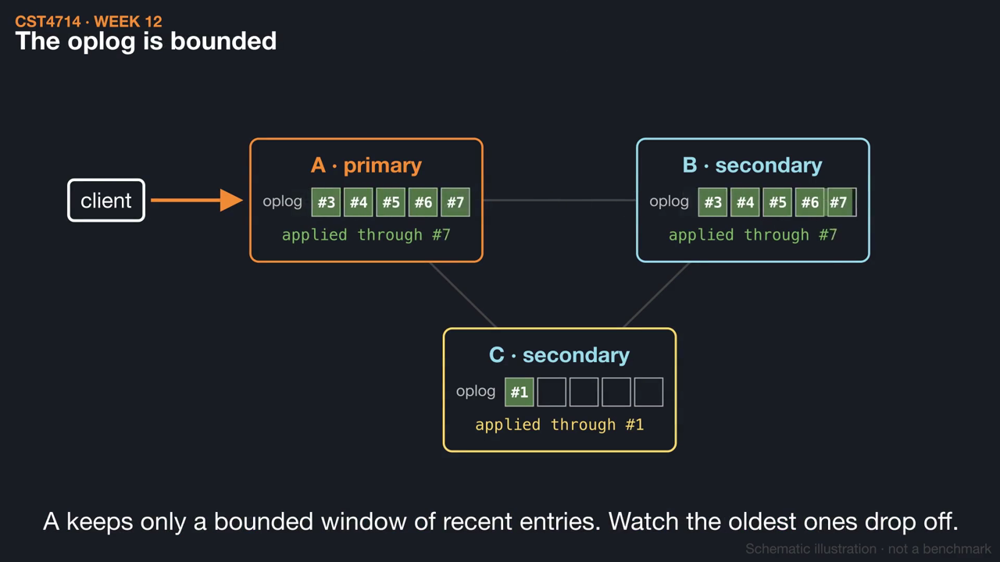
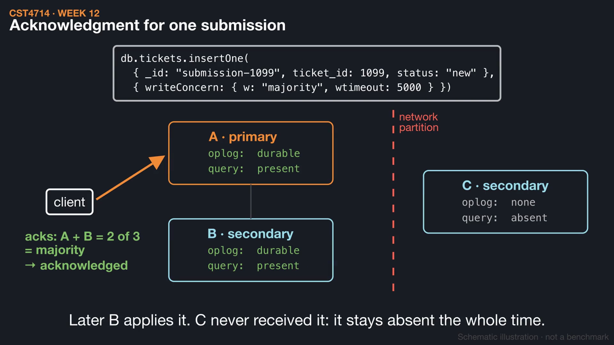
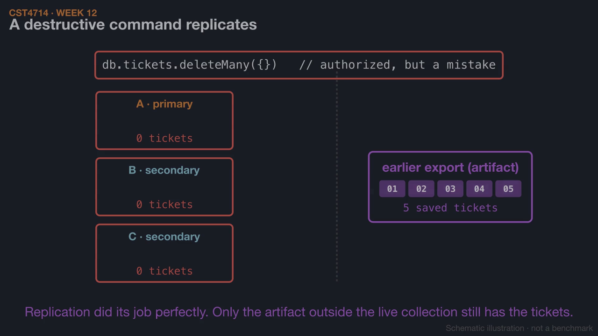

# Week 12 videos

Short silent animations with on-screen captions. Each video has a matching `.srt` subtitle file. Diagrams are schematic illustrations, not benchmarks.

## [Replica sets: oplog, lag, and elections](01_replica_set_election.mp4) (1:24)

A primary records ticket 1099 in its oplog and two secondaries copy it at different speeds. When the primary is lost, a voting majority can elect a new one, but two isolated survivors cannot.

[Watch](01_replica_set_election.mp4) · [Subtitles](01_replica_set_election.srt)

## [Write concern, read preference, and read concern](02_write_read_concern.mp4) (1:39)

Follow submission-1099 while member C is cut off: which acknowledgments w:1, majority, and w:3 can collect, why a timeout means "unknown", and why a read from C can miss a write that A and B kept.

[Watch](02_write_read_concern.mp4) · [Subtitles](02_write_read_concern.srt)

## [Replication is not backup: logical recovery](03_logical_recovery.mp4) (1:31)

A deletion replicates to every member, so only a separate artifact still holds the five tickets. Restore it into a separate target, then catch a wrong subject that the count and ID checks miss and repair it from the saved version.

[Watch](03_logical_recovery.mp4) · [Subtitles](03_logical_recovery.srt)

Editable source: `course/animations/week_12/` in the course authoring folder. Videos © 2026 Atilio Barreda, CC BY-NC-SA 4.0; source code MIT.
