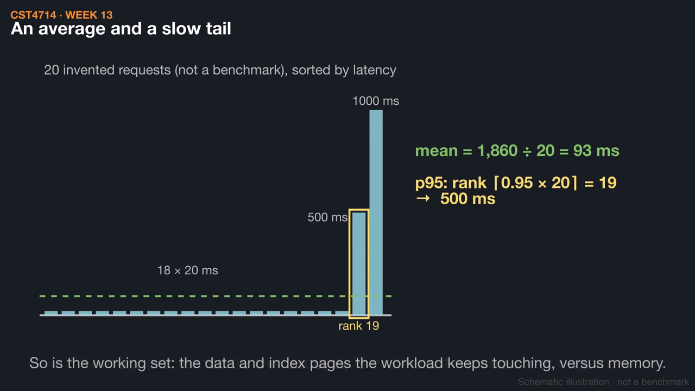
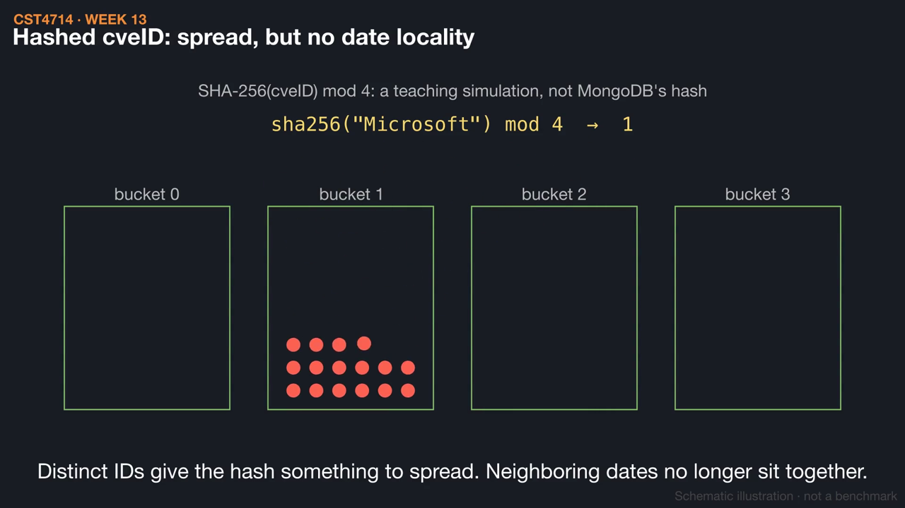
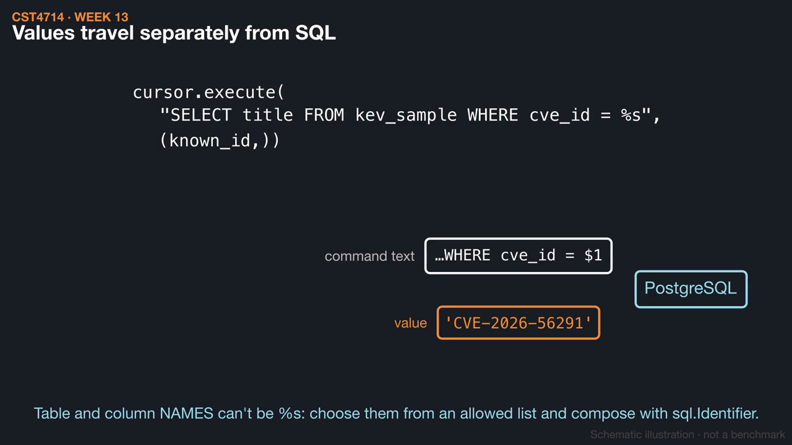

# Week 13 videos

Short silent animations with on-screen captions. Each video has a matching `.srt` subtitle file. Diagrams are schematic illustrations, not benchmarks.

## [Capacity: measure before you scale](01_capacity_before_scaling.mp4) (1:17)

Twenty invented requests average 93 ms while the 95th percentile is 500 ms. Then compare the scaling options by what each one leaves behind, and see why three replicas are copies while three shards are portions.

[Watch](01_capacity_before_scaling.mp4) · [Subtitles](01_capacity_before_scaling.srt)

## [Shard keys: distribution and targeting](02_shard_keys.mp4) (1:37)

Using the 75-record CISA fixture, a ranged dateAdded key sends all 15 later records to the last range, while a hashed cveID spreads them 3, 3, 6, 3. Hashing cannot split a repeated value, and a query without the shard key goes to every shard.

[Watch](02_shard_keys.mp4) · [Subtitles](02_shard_keys.srt)

## [A repeatable Python import](03_repeatable_import.mp4) (1:28)

A Python client connects with a hidden URI, TLS checks on, and timeouts, then imports by a stable key so a second run leaves 75 records instead of 150. A failed write shows the difference between a transaction's rollback and a rerunnable, per-document loop.

[Watch](03_repeatable_import.mp4) · [Subtitles](03_repeatable_import.srt)

Editable source: `course/animations/week_13/` in the course authoring folder. Videos © 2026 Atilio Barreda, CC BY-NC-SA 4.0; source code MIT.
