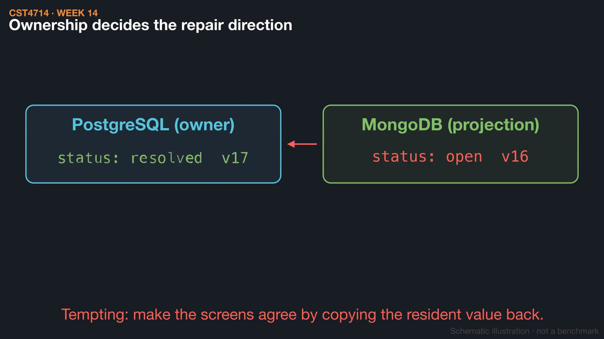
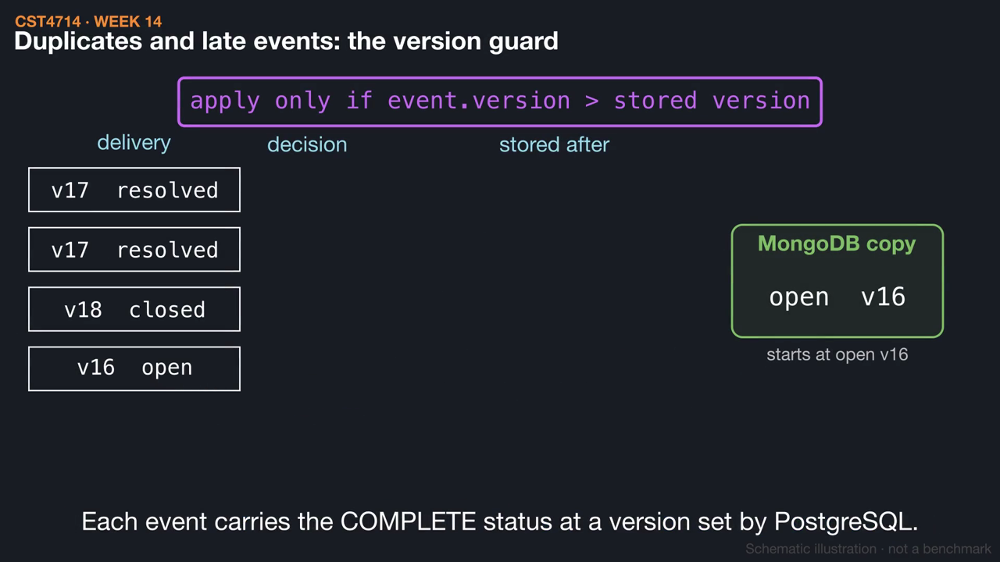
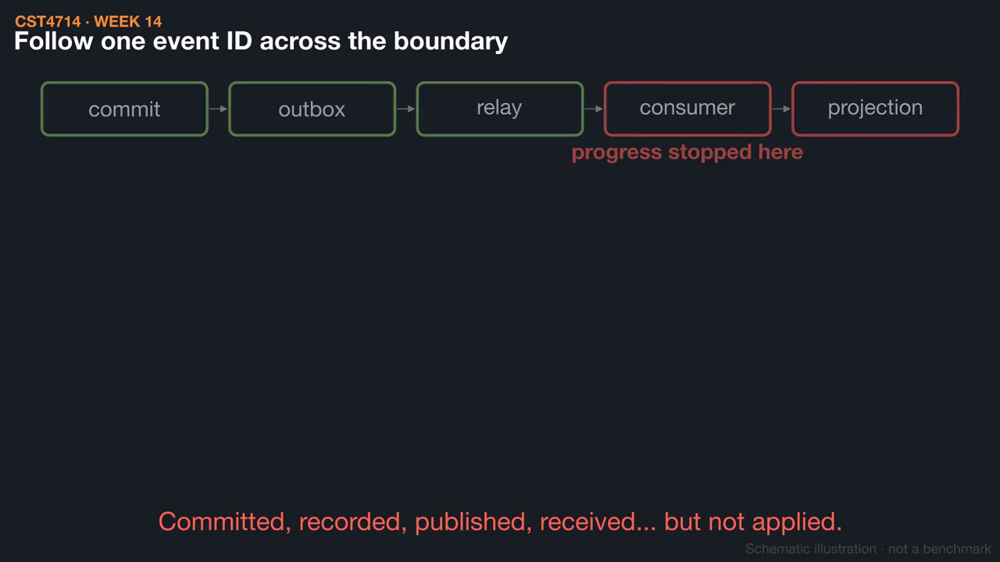

# Week 14 videos

Short silent animations with on-screen captions. Each video has a matching `.srt` subtitle file. Diagrams are schematic illustrations, not benchmarks.

## [Polyglot persistence: one owner per fact](01_one_owner_per_fact.mp4) (1:30)

Two healthy databases can still show two different ticket statuses. Naming one authoritative owner for each fact tells you which copy is derived, how it is refreshed, and which direction a repair must go.

[Watch](01_one_owner_per_fact.mp4) · [Subtitles](01_one_owner_per_fact.srt)

## [Keeping two databases consistent: outbox and version guard](02_outbox_and_versions.mp4) (1:42)

A dual write can commit in PostgreSQL and fail in MongoDB. A transactional outbox records the change and its event together, and a version-checked consumer ignores duplicate and late deliveries.

[Watch](02_outbox_and_versions.mp4) · [Subtitles](02_outbox_and_versions.srt)

## [Triage a cross-database incident](03_incident_triage.mp4) (1:24)

Follow ticket 1008 from commit to event to consumer to projection, find where progress stopped, and repair in the owner's direction. Then check more than one record, because equal counts can hide missing, extra, and wrong values.

[Watch](03_incident_triage.mp4) · [Subtitles](03_incident_triage.srt)

Editable source: `course/animations/week_14/` in the course authoring folder. Videos © 2026 Atilio Barreda, CC BY-NC-SA 4.0; source code MIT.
