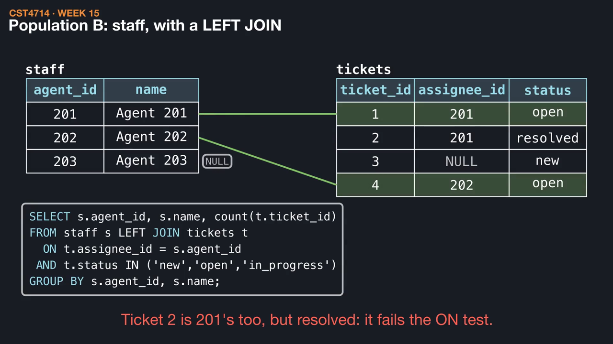
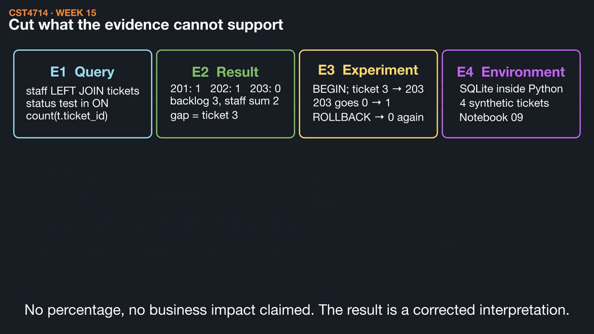
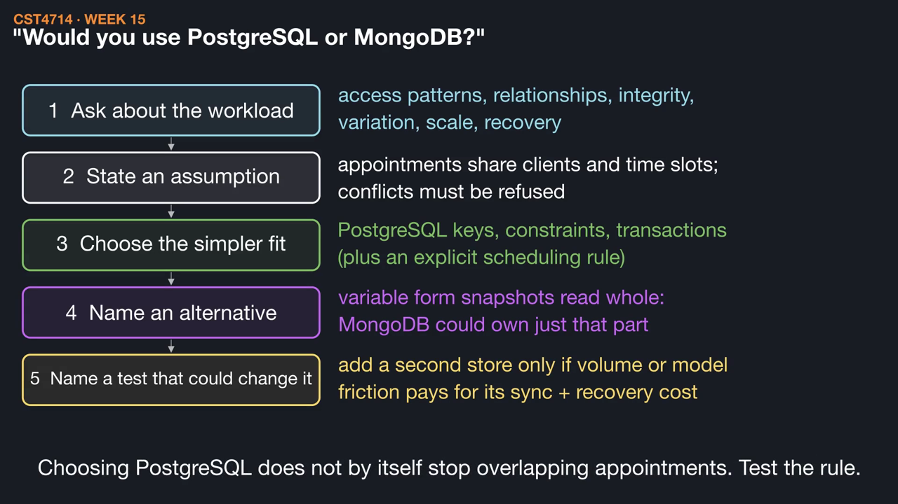

# Week 15 videos

Short silent animations with on-screen captions. Each video has a matching `.srt` subtitle file. Diagrams are schematic illustrations, not benchmarks.

## [Four tickets, two totals: the course in one report](01_four_tickets_two_totals.mp4) (1:32)

The backlog says three active tickets but staff counts add up to two. Define each population, trace the left join, break it on purpose, and recognize the same check in restores and projections.

[Watch](01_four_tickets_two_totals.mp4) · [Subtitles](01_four_tickets_two_totals.srt)

## [From lab evidence to a portfolio bullet](02_evidence_to_bullet.mp4) (1:11)

A tool list says little. Gather the query, result, and experiment you actually ran, build a resume bullet and a STAR-R story where every phrase points to that evidence, and cut claims you cannot support.

[Watch](02_evidence_to_bullet.mp4) · [Subtitles](02_evidence_to_bullet.srt)

## [Presenting a technical decision](03_presenting_a_decision.mp4) (1:19)

Answer "why did you add that index?" with decision, result, and tradeoff, reason through "PostgreSQL or MongoDB?" from stated assumptions, and plan a demonstration with a safe, non-live fallback.

[Watch](03_presenting_a_decision.mp4) · [Subtitles](03_presenting_a_decision.srt)

Editable source: `course/animations/week_15/` in the course authoring folder. Videos © 2026 Atilio Barreda, CC BY-NC-SA 4.0; source code MIT.
